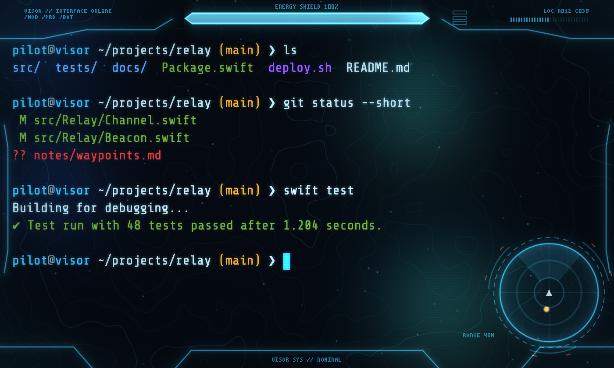
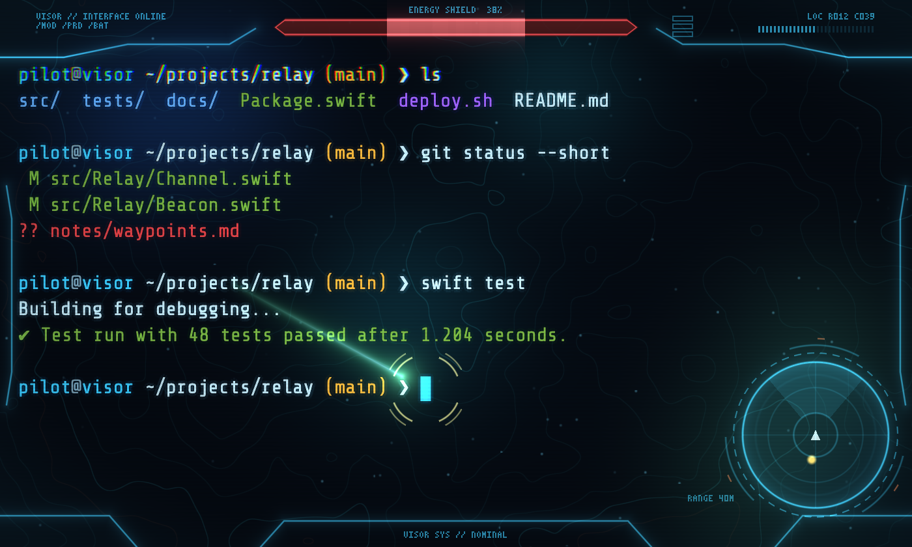

# Visor HUD

A sci-fi helmet visor for your terminal. It's a theme, a GLSL shader and a small
shell hook for [cmux](https://cmux.com) and [Ghostty](https://ghostty.org) on macOS.
The shield bar actually means something: it tracks the git state of the folder each
pane is in, and takes a hit when a command fails.



## What you get

- **Shield bar.** The bar across the top shows the git health of the folder that pane is in:
  full when the repo is clean, lower for every changed file, red and blinking on merge
  conflicts. Every pane has its own.
- **Damage.** A failed command flashes the shield red, knocks it down and lets it
  recharge. Fail a few in a row and the hits stack.
- **Motion tracker.** Bottom right. The gold blip is your cursor.
- **Lock-on and plasma.** When the cursor jumps (after Enter, or moving around in an
  editor) a bolt streaks to the new spot and a reticle locks onto it.
- **Shield flare.** Switching panes plays a short hex-shield flash around the edges.
- **Visor frame, telemetry text, scanlines.** The frame and readouts sit in the window
  padding, so they never cover your text. The `LOC` readout is your cursor's row and column.
- **Holo background.** Drifting contour lines, a bit of bokeh and the occasional
  interference band, drawn only behind empty space.
- **cmux sidebar.** Shields, a tracker with one blip per workspace, and a clickable
  waypoint list.



## Install

You need macOS with [cmux](https://cmux.com) or [Ghostty](https://ghostty.org).
[Homebrew](https://brew.sh) is optional; it's used to install the font.

```bash
curl -fsSL https://raw.githubusercontent.com/iosdec/visor-hud/main/install.sh | bash
```

Or from a clone:

```bash
git clone https://github.com/iosdec/visor-hud.git
cd visor-hud
./install.sh
```

Then, in cmux:

```bash
cmux reload-config
```

and open a new tab. In plain Ghostty, restart it instead. To show the sidebar in cmux,
right-click the sidebar button and pick **visor-hud**.

The installer:

| What | Where |
| --- | --- |
| Shader | `~/.config/ghostty/shaders/visor-hud.glsl` |
| Colour theme | `~/.config/ghostty/themes/Visor` |
| Settings (font, padding, blur, shader) | a marked block at the end of `~/.config/ghostty/config` |
| cmux sidebar | `~/.config/cmux/sidebars/visor-hud.swift` |
| Shield hook | `~/.config/visor-hud/shield.zsh`, plus one line in `~/.zshrc` |
| Font | Share Tech Mono, via Homebrew |

It backs up every file it edits (`*.visor-backup-<date>`) and is safe to run again
to update. Skip parts with `--no-shell` or `--no-font`.

## Tweaking

Every effect has a switch at the top of `~/.config/ghostty/shaders/visor-hud.glsl`.
Set one to `0`, save, and run `cmux reload-config`.

| Switch | Does |
| --- | --- |
| `SHOW_FRAME`, `SHOW_TEXT`, `SHOW_SHIELD` | Visor frame, telemetry text, shield bar |
| `SHOW_TRACKER`, `TRACKER_LEFT` | Motion tracker, and whether it sits bottom-left |
| `SHOW_RETICLE`, `SHOW_PLASMA`, `SHOW_FLARE` | Cursor and focus effects |
| `SHOW_BOKEH`, `SHOW_TOPO`, `SHOW_DUST`, `SHOW_INTERFERENCE` | Background atmosphere |
| `SHOW_GLOW`, `SHOW_SCANLINES` | Text glow and scanlines |
| `DIM_UNFOCUSED` | Dim panes you're not in |
| `SHIELDS_UP_UNFOCUSED` | Keep shields full in panes you're not in |
| `SHELL_SHIELD` | Drive the shield bar from the shell hook |
| `FLIP_Y` | Set to `1` if the HUD draws upside down |

The window settings (opacity, blur, font size, padding) live in the `visor-hud`
block of `~/.config/ghostty/config`. If you change the padding, the frame may
overlap your text; `48,30` is what the HUD is laid out for.

## How the shield works

A shader can only see what the terminal gives it: the screen, the cursor, focus and
the colour palette. So the shell hook writes the shield level into palette colour 255
with an escape code after every command, and the shader reads it back. Each pane has
its own palette, which is why each one gets its own shield. `git status` runs in the
background, so your prompt never waits for it.

The catch: colour 255 (normally the brightest grey) gets a slight tint. Hardly anything
uses that exact colour.

## Preview in a browser

`preview/` renders the shader over a fake terminal session, which is handy for
tweaking without reloading your terminal:

```bash
python3 -m http.server 8000
open http://localhost:8000/preview/
```

Add `?t=3.2` to freeze time, `&shield=0.4&mode=hit` to show a hit, or `&focus=0` for
an unfocused pane.

## Uninstall

```bash
~/.local/share/visor-hud/uninstall.sh   # if you used the curl installer
./uninstall.sh                          # from a clone
```

It removes everything listed above and puts your previous cmux theme back. Backups
from the install are left alone.

## Notes

This is a fan project inspired by the Halo series. It isn't affiliated with or
endorsed by Microsoft or 343 Industries, and it contains no artwork, logos or
assets from the games. Everything is drawn by the shader.

MIT licensed. Share Tech Mono is a Google Font under the SIL Open Font License and
isn't bundled here.
